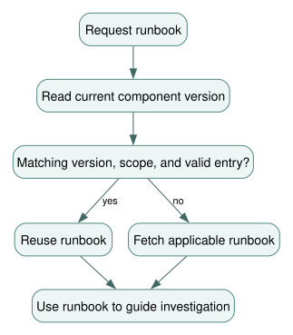

# Cache policy

A runbook gives instructions for a service. Before reusing a saved copy, make sure that it covers the current version and the reader can access it.

Draft for [issue 7](https://github.com/jpboliv/meridian-agents/issues/7). A runbook stays the same while the deployed component changes. Its content can still be correct even when its selection is wrong.

Specify the key, reader scope, source version, expiry, and invalidation event for each reusable result. Distinguish reused answers from provider prompt caching. Describe how a cache hit affects simulated time.
