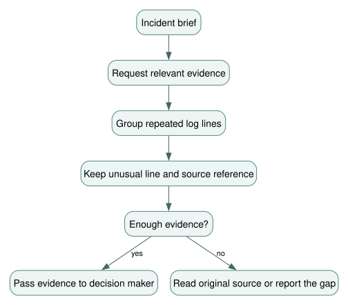

# Context selection

When many log lines repeat the same error, summarize them. Keep the unusual line and a link to the original log.

Draft for [issue 5](https://github.com/jpboliv/meridian-agents/issues/5). One unusual log line explains a thousand similar errors. What survives when the context budget is full?

Specify the initial context, retrieval triggers, limits, and evidence references. Test whether the investigator can recover the original line from its summary.
