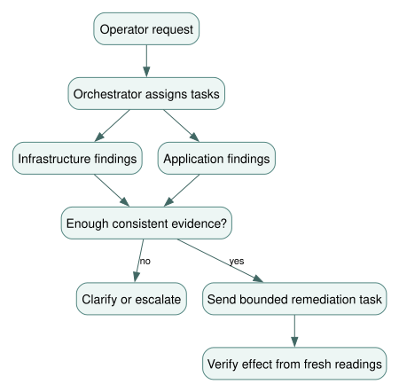

# Specialist handoffs

Each specialist reports what they found and where they found it. If they disagree, the agent leading the investigation asks for more evidence before anyone changes the system.

Draft for [issue 10](https://github.com/jpboliv/meridian-agents/issues/10). Two specialists report different causes. What evidence must the orchestrator request before it sends a remediation task?

Define the task, result, uncertainty, constraints, and evidence references. Include a missing or invalid result and a limit on follow-up requests.
