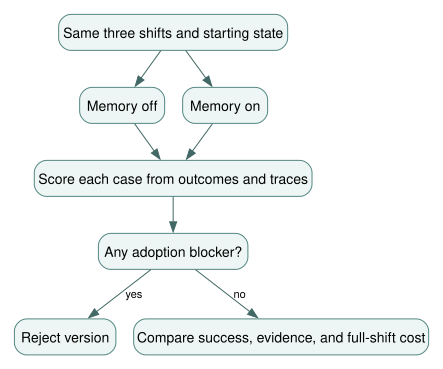

# Evaluation contract

Run the same three shifts with memory off and on. For each incident, count how often each version makes the right decision and can show why. Then compare costs.

Draft for [issue 8](https://github.com/jpboliv/meridian-agents/issues/8). A faster run restarts the wrong instance. Decide which failures rule out adoption even when average cost falls.

Compare versions on the same starting state. Reset memory between independent trials and preserve it across shifts within a trial. Record per-case outcomes, effects, source calls, and model usage.

## Agreed metrics

Report verified successes as passes out of runs for each case. A pass requires the expected decision, permitted effects, and evidence for the final report. When evidence is unavailable, an honest incomplete result can pass.

| Question | Measurement |
|---|---|
| Does memory help on recurrence? | Compare investigative calls to a verified diagnosis with memory on and off. Report failures beside call counts. |
| Does memory mislead after a change? | Count runs that apply the previous fix despite contradictory evidence, out of changed-cause runs. |
| Does selected context keep the clue? | Count runs where the deciding agent received the decisive observation and its source reference before deciding. Report total input tokens alongside this count. |
| Is reuse safe and useful? | Compare source calls with and without caching. Count stale or out-of-scope results served after changes to facts, versions, or permissions. |

An observed unauthorized effect, duplicate effect, data leak, or unsupported recovery claim blocks adoption. Compare cost over the whole shift sequence, including memory writes, retrieval, and correction.

First experiment: run the initial incident, a genuine recurrence, and a similar alert with a different cause. Compare memory on and off with the same model, cases, budgets, and cache policy. Trial counts and case-specific evidence remain open.
