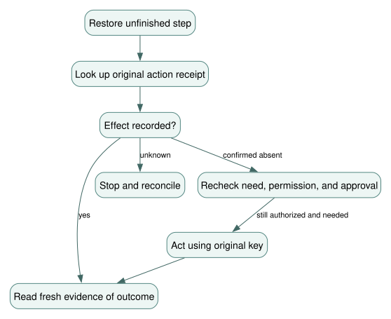

# Interruption and resume

A missing reply does not mean the restart failed. Find the original receipt before deciding what work remains.

Draft for [issue 11](https://github.com/jpboliv/meridian-agents/issues/11). A restart takes effect just before the worker loses its response. A later worker sees an unfinished step.

Specify what survives the interruption and how the worker finds the original action receipt. Define fresh evidence and permission checks before the worker carries out any remaining step. The demonstration must count applied effects.
