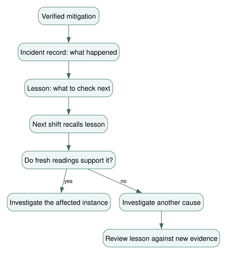

# Memory lifecycle

We agreed to keep two records. The incident record says what happened. The lesson tells the next shift what to check. Today’s readings determine whether the same fix fits.

## Agreed handover evidence

Name the affected component or instance. Give the readings and their times. Link each observation to its source and each action to its executor record. Describe what happened afterward. Include missing or conflicting evidence when it changes the conclusion.

One documented incident can support a clue about what to check next. Link the clue to its incident record and say when it applies. Recovery after an action, by itself, does not prove that the action caused recovery.

Other memory policies remain draft for [issue 6](https://github.com/jpboliv/meridian-agents/issues/6).

Use the next shift to test applicability. Specify who can write or retrieve the record, how conflicts appear, and what deletion means for derived summaries.
