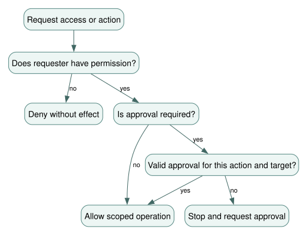

# Permissions and approvals

First, find out whether this person has permission to restart the service. If this restart also needs approval, ask for it before proceeding.

Draft for [issue 9](https://github.com/jpboliv/meridian-agents/issues/9). A support user requests a cached summary that an on-call engineer produced. Does the summary reveal information outside the user's scope?

Specify the effective identity, approval scope, data masking, and denial response. Test both an allowed action and a denied action against actual effects.
