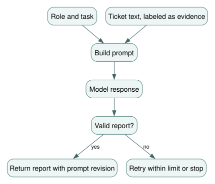

# Prompt structure

A prompt tells the agent what to do. A ticket describes what someone saw. If a ticket says to restart a service, those words do not give the agent permission.

Draft for [issue 4](https://github.com/jpboliv/meridian-agents/issues/4). A ticket quotes a prior shift's instructions. Where does that quote appear in the model input, and how does the agent know its source?

Define the stable instructions, task input, trust boundaries, and output contract. A trace must identify which revision produced a report.
